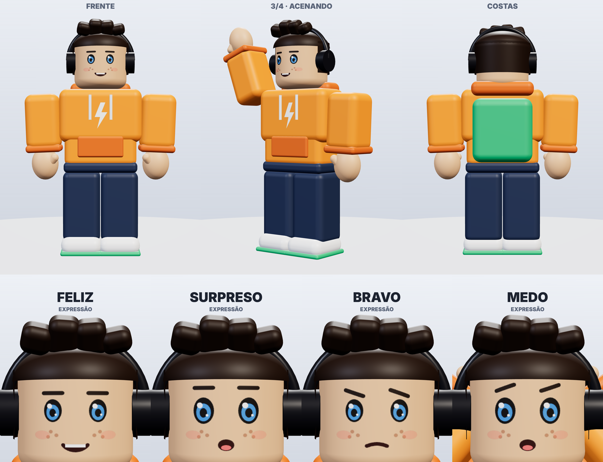

# Personagens em blocos (estilo avatar Roblox 3D)

- **Modelo 3D:** `estudio3d/personagem-bloco.js`, pela função `criarAvatarBloco(opções)`.
- **Fichas fixas:** `estudio3d/personagens-bloco.js`. As cores e os acessórios ficam travados lá.
- **Imagem de referência:** `node estudio3d/render3d.js ficha-bloco --previa --sem-voz`.

---

## ZECA



| # | Item | Ficha |
|---|---|---|
| 1 | Nome | **Zeca** |
| 2 | Idade aparente | 12 anos |
| 3 | Formato do corpo | Avatar em blocos clássico: tronco largo e quadrado, braços e pernas retos, mãos e pés em bloco de cantos arredondados, cabeça quadrada |
| 4 | Pele | Bege-morena clara (#E8B48A), com sardas leves nas bochechas |
| 5 | Cabelo | Castanho-escuro quase preto (#2B1A10), topete espetado em 4 mechas de bloco viradas para a frente e laterais curtas |
| 6 | Olhos e expressão | Olhos grandes ovais **azuis** (#3E8EDE) com dois brilhos, sobrancelhas grossas e bochechas rosadas. Expressão padrão: sorriso aberto mostrando os dentes |
| 7 | Roupa | Moletom **laranja** (#FF8A1F) com punhos, bolso canguru e capuz em laranja-escuro (#E0661A). Tem **um raio branco no peito** e cordões brancos. Calça jeans azul-escura (#2D3B55) |
| 8 | Calçados | Tênis brancos com **sola verde** (#22B573) |
| 9 | Acessórios | **Fone de ouvido preto** sobre a cabeça e **mochila verde** (#22B573) nas costas |
| 10 | Personalidade | Elétrico, curioso, corajoso demais para o próprio bem e engraçado. Sempre se mete em encrenca primeiro e pensa depois |
| 11 | O que NUNCA muda | O moletom laranja com raio branco, os olhos azuis, as sardas, o topete escuro, o fone preto, a mochila e a sola verdes, e as proporções em bloco |

### Prompt de referência (EN)

> Roblox-style 3D blocky avatar character, full body, front view, standing straight with arms relaxed at the sides, neutral light-grey studio background with soft floor shadow. Original character "Zeca", 12 years old: square head with rounded edges, light tan skin with light freckles, big oval blue eyes with white highlights, thick dark eyebrows, wide happy open smile showing teeth. Dark-brown blocky spiky quiff hairstyle, black over-ear headphones on the head. Bright orange hoodie with darker-orange cuffs, kangaroo pocket and hood, white lightning bolt logo on the chest, white drawstrings. Dark-blue jeans, white chunky sneakers with green soles, green backpack. Smooth plastic materials, clean textures, modern Roblox game look, professional 3-point lighting, high-quality 3D render, sharp details, 9:16.

### Prompts de cena (mesma ficha; troque só pose, expressão e cenário)

1. **Ação:** *Roblox-style 3D blocky avatar "Zeca" (same look as reference: orange hoodie with white lightning bolt, dark-blue jeans, white sneakers with green soles, black headphones, green backpack, dark spiky quiff, blue eyes, freckles), running toward the camera with a surprised open-mouth face. Colorful obby parkour map with floating platforms and a bright blue sky. Dynamic low angle, motion blur on the background, cinematic lighting, high-quality 3D render, 9:16.*
2. **Thumbnail:** *Roblox-style 3D blocky avatar "Zeca" (same reference look), close-up from the chest up, shocked face with huge eyes and open mouth, hands on head, bright red-to-yellow gradient background, strong rim light, glossy plastic materials, very sharp, thumbnail composition with empty space on the right, 9:16.*
3. **Medo:** *Roblox-style 3D blocky avatar "Zeca" (same reference look) standing in a dark hallway lit by a flickering flashlight, scared face with raised eyebrows, holding the flashlight, blue moonlight from a window, volumetric light, cinematic, high-quality 3D render, 9:16.*

### No estúdio 3D

```js
import { criarAvatarBloco } from '../personagem-bloco.js';
import { ZECA } from '../personagens-bloco.js';
const zeca = criarAvatarBloco(ZECA);     // nunca mude as cores aqui
zeca.estado = { bracos: 'aceno', expr: 'feliz', andar: 1, falando: true };
// expressões: neutro, feliz, surpreso, serio, bravo, medo
// braços: normal, aceno, cima, aponta, cabeca, abre, corre
```
